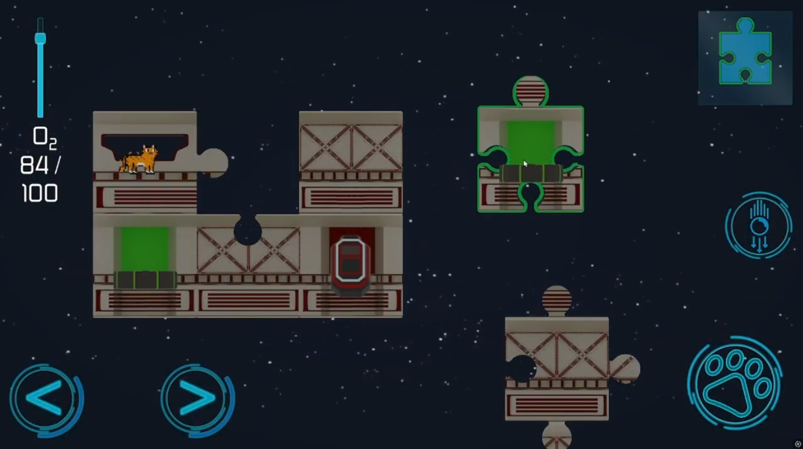

# Félicette: Space Puzzle
## Logic puzzle game
Game created for the [ZTGK 2025](https://gry.it.p.lodz.pl/main/index.php/pl/) competition in category: Mobile Games. 

## How to run
This repo does not contain any Android or Desktop releases. In order to run the game one must clone the repo and run the project in Unity editor (ver. Unity 6+)

## Target platforms
- [x] Windows
- [x] Android

## Authors and contributors (Crunchy Catnip team):
[Eques72](https://github.com/Eques72) [NataliaMalejka](https://github.com/NataliaMalejka) [nyaanon](https://github.com/nyaanon) [Pit4g0](https://github.com/Pit4g0)

## External resources used in project 
[Sci-fi GUI skin by 3d.rina](https://assetstore.unity.com/packages/2d/gui/sci-fi-gui-skin-15606)

## License
Shield: [![CC BY-NC 4.0][cc-by-nc-shield]][cc-by-nc]

This work is licensed under a
[Creative Commons Attribution-NonCommercial 4.0 International License][cc-by-nc].

[![CC BY-NC 4.0][cc-by-nc-image]][cc-by-nc]

[cc-by-nc]: https://creativecommons.org/licenses/by-nc/4.0/
[cc-by-nc-image]: https://licensebuttons.net/l/by-nc/4.0/88x31.png
[cc-by-nc-shield]: https://img.shields.io/badge/License-CC%20BY--NC%204.0-lightgrey.svg
